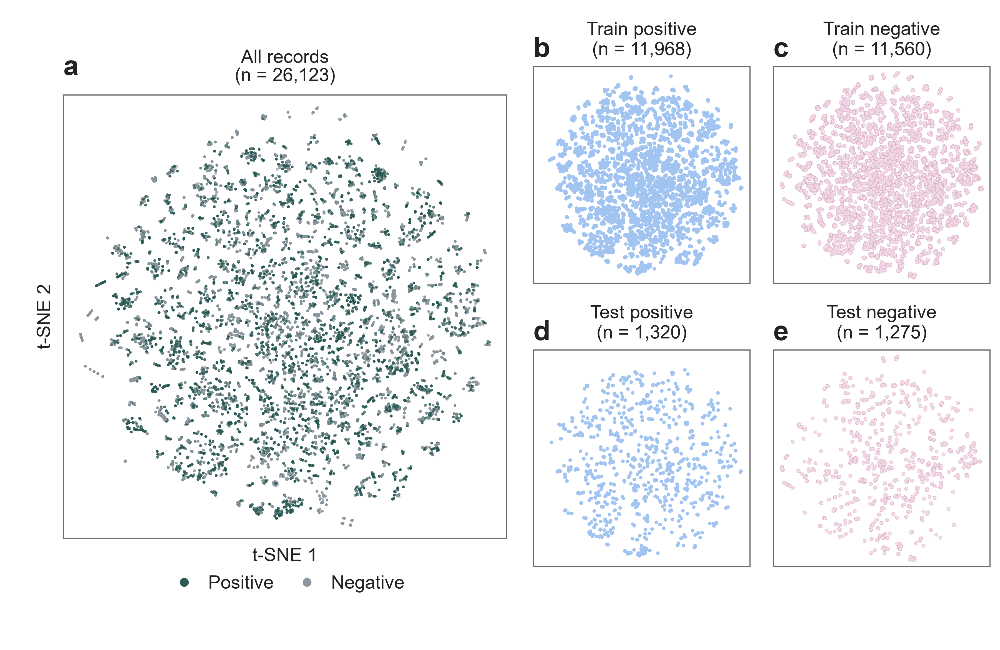

# Processed-data training and holdout JSONL

Training and holdout files prepared from the [processed positive and negative records](../processed_data/README.md).

| File | Contents |
| --- | --- |
| [train.jsonl](train.jsonl) | Fine-tuning training records |
| [holdout.jsonl](holdout.jsonl) | Holdout records for model evaluation |
| [holdout_smiles.jsonl](holdout_smiles.jsonl) | SMILES version for baseline testing |
| [holdout_smiles_provenance.json](holdout_smiles_provenance.json) | Chemical mapping qualifications for the SMILES version |
| [class_map.json](class_map.json) | P = success; N = failure |
| [manifest.json](manifest.json) | JSONL checksums, file identities, and label counts |

`holdout_smiles.jsonl` contains the same 2,595 records, labels and numerical conditions for baseline testing. Its four chemical fields are arrays of unique canonical SMILES; `[]` means no reagent. Each array item retains its reagent-level grouping, including salt or hydrate fragments. The provenance file marks the 19 assumption-affected records and other partial/component representations; the arrays do not imply complete material structures.

| Partition | P | N | Total | Clusters |
| --- | ---: | ---: | ---: | ---: |
| Training | 11,968 | 11,560 | 23,528 | 11,157 |
| Holdout | 1,320 | 1,275 | 2,595 | 1,231 |

Each JSONL record contains system, user, and assistant messages. The user message contains eight reaction-condition fields; the assistant answer is `P` or `N`. Training and holdout use separate chemistry clusters, with a P:N ratio of 88:85 in each partition. See [split preparation](../../docs/datasets.md) for the filtering and grouping rules.

## Process-enriched dataset

[processed_enrich_11field/](processed_enrich_11field/README.md) retains the archived records, order, labels, and training inputs, adding `vessel_type`, `vessel_volume_mL`, and `agitation`. Holdout rows 1,675 and 2,206 include the requested corrections; other inputs retain their archived values, so these controls are not fully identical to the current baseline's eight inputs.

[processed_enrich_9field/](processed_enrich_9field/README.md) adds only `stirring` (`yes`, `no`, or `not reported`) to the original eight inputs, with a corresponding nine-field system prompt.

## Publication-year splits

- [year_split_4/](year_split_4/README.md): four individual time blocks and two cumulative training subsets.
- [year_split_5/](year_split_5/README.md): five individual time blocks and three cumulative training subsets.

These JSONL files preserve the original Step 5 exports and use the shared [holdout.jsonl](holdout.jsonl).

## Training-data ablations

- [artificial_perturbation/](artificial_perturbation/README.md): field-matched and count-matched training sets replacing reconstructed negatives with artificial perturbations of training positives.
- [leave_one_perturbation_out/](leave_one_perturbation_out/README.md): one training set removing single-field negative neighbors and five equally sized random-drop controls.

Both folders retain the archived study holdout used with the existing trained baseline. These frozen study files preserve their original conditions and do not incorporate later corrections to the current holdout.

## Training and test visualization



The [analysis notebook](../../Demo/04_dataset_analysis/dataset_analysis.ipynb) generates these plots; test panels use the holdout partition above.

## Regenerate from processed data

From the repository root:

```bash
python -m mofinder.datasets.prepare prepare --config configs/dataset_preparation.json
```

This reads the processed CSVs and publication years, then writes training, holdout, split metadata, and publication-year subsets under `results/datasets/conditions/`.

To prepare newly generated curation outputs, use [dataset_preparation_from_curation.json](../../configs/dataset_preparation_from_curation.json). Optional linker-prime corrections can be regenerated from the current CSV with `python -m mofinder.curation.linker_primes data/processed_data/processed_negative.csv results/local/negative_prime_corrected.csv --lookup data/organic_linker_info/linker_prime_corrections.json`; use a separate dataset configuration for that output.

## Source rows for regenerated datasets

Dataset preparation writes `mof_ft_split_assignments.csv` and `mof_ft_split_summary.json` beside each newly generated train/holdout pair under `results/datasets/conditions/`. Use those assignments only with the exact inputs and JSONL pair from the same preparation run. Source row IDs refer to the positive and negative tables used for that run, before filtering; `is_success` is `True` for P and `False` for N.

The released JSONL identities and label counts are recorded in `manifest.json`. Process-enrichment regeneration requires an explicitly supplied assignment table that matches the selected baseline records; a source mapping is not inferred from a different dataset version.

## Use the final records

Training instructions:

- [GPT-4.1 in the OpenAI dashboard](../../docs/training_openai.md): upload the training JSONL and enter the recorded hyperparameters.

See [holdout evaluation](../../docs/holdout_evaluation.md) to evaluate a configured model. Live evaluation sends only the system instruction and reaction conditions; the reference answer stays local for scoring.
