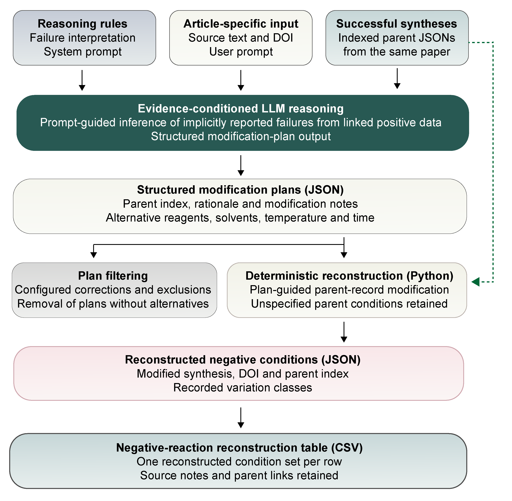

# Negative extraction

Negative extraction links reported failure conditions to successful syntheses
and reconstructs the corresponding negative recipes.



## Benchmark evaluation

The [reference workbook](../benchmarks/negative_reconstruction/ground_truth.xlsx)
contains 431 scored conditions and 36 accepted alternatives from 100 papers.
Its single sheet displays `Negative condition`, `A1 contribution` through
`A4 contribution`, and `Optional: comment by contributing annotator`.
`Yes` marks contributor attribution; previously unassigned rows default to `A1`.
Contribution flags and optional comments do not affect scores.
`OPTIONAL ALL` accepts outputs satisfying every listed constraint, but its recovery
is not required for recall, paper completion or reference accuracy.
Record IDs identify the paper and successful parent. Matching context is stored
within the workbook.

Evaluate the two supplied *gpt-5.5* outputs, extra high and no reasoning,
without making model requests:

```bash
python -m pip install -e ".[evaluation]"
python -m mofinder.evaluation.negative data/processed_data/negative_extraction_gpt55_xhigh.csv
python -m mofinder.evaluation.negative data/processed_data/negative_extraction_gpt55_none.csv
```

Use another CSV as the positional argument and `--ground-truth` to select
another compatible workbook. Results are saved under `results/negative_extraction/`.

A paper is recovered when every eligible successful parent has a distinct,
compatible negative prediction. At record level, precision is supported records
divided by evaluated output records, and recall is recovered conditions divided
by scored reference conditions. Counts are pooled across papers (micro-averaged).
Coverage F1 is their harmonic mean; output records and reference conditions are
different observation units. Counts and excluded outputs are saved for inspection.

Separate fixed-reference accuracy uses 431 negative-condition rows and 160
associated successful controls. It is `(recovered conditions + retained controls)
/ 591`, where a control is retained if its recorded profile is not emitted as a
negative recipe. Controls match all recorded recipe values; unknown quantities
are unconstrained. Field-associated accuracy uses the corresponding reference
rows and controls. This accuracy has its own denominator and does not share a
single confusion matrix with output precision and condition recall.

See [negative reconstruction](negative_reconstruction.md) for extraction commands.
