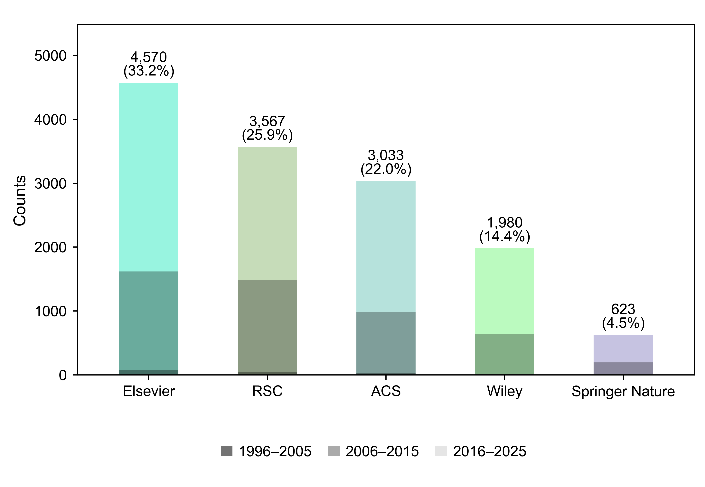

# Literature coverage



Bars count 13,773 bibliography records representing 13,770 unique DOIs before triage. Percentages use all 13,773 records, including duplicate DOI rows.

[Source records](publisher_source_records.csv), [publisher mappings](publisher_name_mapping.csv), and [period counts](publisher_period_counts.csv) are included. The [dataset notebook](../../Demo/04_dataset_analysis/dataset_analysis.ipynb) reproduces the figure.

## Reproduce

From the repository root:

```bash
python -m pip install -e ".[plotting,notebook]"
python -m mofinder.plotting.literature_triage_figures --source docs/triage_figures/publisher_source_records.csv --mapping docs/triage_figures/publisher_name_mapping.csv --output-dir docs/triage_figures
```

This writes a 6-inch, 600 dpi PNG, PDF, SVG, and summary CSV using the shared [plotting module](../../src/mofinder/plotting/literature_triage_figures.py).
